<div align="center">

# retro-filter

**N'importe quelle fenêtre Windows avec les couleurs des PC des années 80.**

Un jeu, une vidéo, une page web : retro-filter les affiche en CGA (4 couleurs) ou en EGA (16 couleurs), en direct.

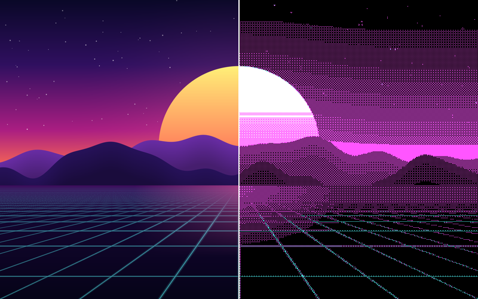


[English](README.md) · **Français**

[Présentation](https://sebjvproj.github.io/retro-filter/) · [Utilisation](#utilisation) · [Palettes](#les-palettes) · [Compiler](#compiler-et-lancer) · [Comment ça marche](#comment-ça-marche)

</div>

## En bref

- **Rien à installer dans le jeu.** Le filtre se pose par-dessus la fenêtre, sans rien modifier ni injecter dans le programme filtré.
- **On joue normalement.** La fenêtre garde le clavier et la souris, les clics traversent le filtre.
- **Toute la fenêtre ou une zone.** Tracez un rectangle à la souris pour ne filtrer que la vidéo d'une page web.
- **Rapide.** Le calcul se fait sur la carte graphique, en 1 à 4 millisecondes par image en 1920×1080.
- **Privé.** Aucun accès réseau, tout reste sur votre machine.

Le projet est un prototype qui fonctionne, encore en cours de développement. L'interface existe en français et en anglais.

## Deux modes

| Moderne | Historique |
|:---:|:---:|
| 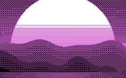 | 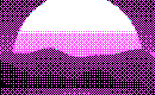 |
| Tramage fin, à la résolution de l'écran. L'image reste lisible et les dégradés se fondent. | 320×200, gros pixels : ce qu'affichait vraiment un PC de 1981. |

## Les palettes

Les images sont des extraits à taille réelle de la sortie de l'app.

### CGA, 4 couleurs (1981)

| | | |
|:---:|:---:|:---:|
| 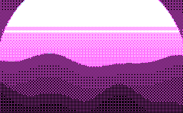 | 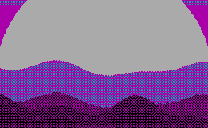 | 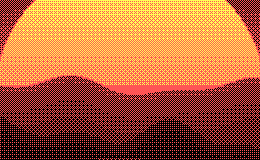 |
| cyan, magenta, blanc | cyan, magenta, gris (sombre) | vert, rouge, jaune |
| 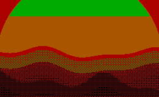 | 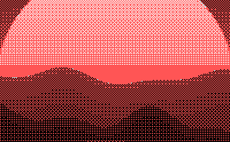 |  |
| vert, rouge, marron (sombre) | cyan, rouge, blanc | gris |

### EGA, 16 couleurs (1984)

| | |
|:---:|:---:|
| 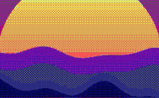 | 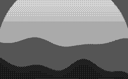 |
| 16 couleurs | gris |

## Utilisation

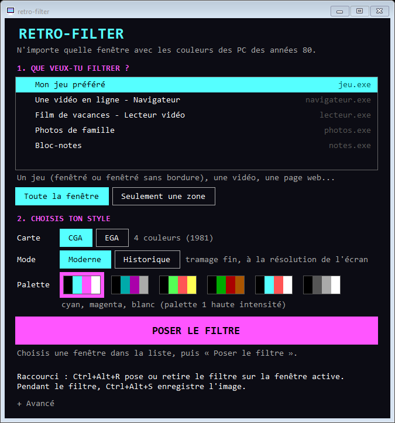

1. Ouvrez ce que vous voulez filtrer. Pour un jeu, choisissez le mode **fenêtré** ou **fenêtré sans bordure** dans ses options d'affichage.
2. Dans retro-filter, choisissez la fenêtre dans la liste, puis **Toute la fenêtre** ou **Seulement une zone**.
3. Choisissez le style : la **carte** (CGA ou EGA), le **mode** (Moderne ou Historique) et la **palette**.
4. Cliquez sur **Poser le filtre**. Avec une zone, tracez d'abord le rectangle à la souris.

La croix de la fenêtre la cache seulement : l'app continue dans la zone de notification. Un clic sur son icône la rouvre, un clic droit donne les mêmes choix et permet de quitter.

L'app démarre en français sur un Windows en français, en anglais sinon. La langue se change dans « Avancé ».

<br clear="right">

### Raccourcis

| Raccourci | Effet |
|---|---|
| <kbd>Ctrl</kbd>+<kbd>Alt</kbd>+<kbd>R</kbd> | Pose le filtre sur la fenêtre active, ou le retire |
| <kbd>Ctrl</kbd>+<kbd>Alt</kbd>+<kbd>S</kbd> | Pendant le filtre : enregistre l'image filtrée et l'image d'origine en PNG dans `Images\retro-filter` |

<kbd>Ctrl</kbd>+<kbd>Alt</kbd>+<kbd>R</kbd> est le seul raccourci réservé en permanence. D'autres raccourcis (carte, mode et palette suivants, barre d'informations) s'activent dans « Avancé ».

## Compiler et lancer

Il faut :

- Windows 10 version 2004 ou plus récent. Windows 11 24H2 est conseillé : avant cette version, Windows limite la capture à environ 60 images par seconde.
- Une carte graphique compatible Direct3D 11.
- Le [kit .NET 8 SDK](https://dotnet.microsoft.com/download) (`winget install Microsoft.DotNet.SDK.8`).

```
cd src/RetroFilter
dotnet build
bin\Debug\net8.0-windows10.0.26100.0\RetroFilter.exe
```

## Limites connues

- **Plein écran exclusif** : le filtre ne peut pas s'afficher par-dessus. Passez le jeu en fenêtré sans bordure.
- **Vidéos protégées** (la plupart des services de vidéo payants) : Windows renvoie une image noire à la capture.
- **Retard** : l'image filtrée arrive au moins une image après celle du programme filtré.
- **HDR** : la capture se fait en 8 bits par couleur, le rendu d'un jeu en HDR n'a pas été testé.
- **Zone** : elle reste fixe par rapport à la fenêtre et n'est pas mémorisée d'une fois sur l'autre.

## Vie privée et système

- L'app ne fait aucun accès réseau. Les images capturées restent sur votre machine.
- Les réglages sont enregistrés dans `%APPDATA%\retro-filter\settings.json`.
- Pour rester fluide quand un jeu occupe toute la carte graphique, l'app demande à Windows la priorité GPU « temps réel ». Aucun droit administrateur n'est nécessaire.

## Comment ça marche

1. **Capture** de la fenêtre par Windows Graphics Capture, la même technique qu'OBS.
2. **Tramage** dans un shader HLSL ([dither.hlsl](src/RetroFilter/Shaders/dither.hlsl)), pour chaque point de l'image :
   - moyenne de la zone en lumière linéaire ;
   - recherche de la paire de couleurs de la palette et de la proportion de mélange qui imitent le mieux la couleur (tramage de Yliluoma), l'écart étant mesuré dans l'espace OKLab, proche de la perception humaine ;
   - une matrice de Bayer 4×4 décide laquelle des deux couleurs afficher.
3. **Affichage** dans une fenêtre transparente aux clics, maintenue juste au-dessus de la fenêtre filtrée.

Les mélanges de chaque paire de couleurs sont calculés une fois par le programme ([DitherTable.cs](src/RetroFilter/DitherTable.cs)) et non pour chaque point : c'est ce qui rend les 16 couleurs de l'EGA utilisables en direct.

## Contenu du dépôt

| Dossier | Contenu |
|---|---|
| `src/RetroFilter/` | L'app (C#, .NET 8, WinForms, Direct3D 11 avec [Vortice.Windows](https://github.com/amerkoleci/Vortice.Windows)) |
| `shaders/` | Les shaders d'origine au format RetroArch `.slang`, qui ont servi à mettre l'algorithme au point. Voir [shaders/README.md](shaders/README.md) |
| `tools/` | `preview.py` applique l'algorithme à une capture d'écran, `compare_gpu.py` compare la sortie de l'app à ce simulateur, `demo_scene.py` dessine la scène de démonstration de cette page |
| `docs/` | Les images de cette page, produites par l'app à partir de la scène de démonstration |

<details>
<summary><b>Modes de test en ligne de commande</b></summary>

<br>

`RetroFilter.exe` accepte des modes sans interface, utiles pour vérifier un changement. `<titre>` est une partie du titre de la fenêtre visée.

| Commande | Effet |
|---|---|
| `--image <fichier> <dossier> [options]` | Filtre un fichier image, sans fenêtre (`palette=N`, taille de pixel, `0` pour le mode historique) |
| `--snapshot "<titre>" <dossier>` | Capture une fenêtre et enregistre l'image d'origine et l'image filtrée |
| `--verify "<titre>"` | Compare le shader rapide au shader de référence, pour toutes les palettes |
| `--bench "<titre>"` | Mesure le temps de traitement par image |
| `--fps "<titre>" <0\|1\|2>` | Mesure le débit de capture selon la priorité GPU |
| `--overlay "<titre>" <dossier>` | Vérifie que le filtre reste collé à la fenêtre et que les clics le traversent |
| `--ui-test <dossier> [demo]` | Enregistre des captures de l'interface |

Les images de cette page se refont ainsi :

```
python tools/demo_scene.py docs/scene.png 800 500
RetroFilter.exe --image docs/scene.png <dossier> palette=0
```

</details>

## Licence

[MIT](LICENSE).
