<div align="center">

# retro-filter

**Any Windows window, in the colors of a 1980s PC.**

A game, a video, a web page: retro-filter shows them in CGA (4 colors) or EGA (16 colors), live.

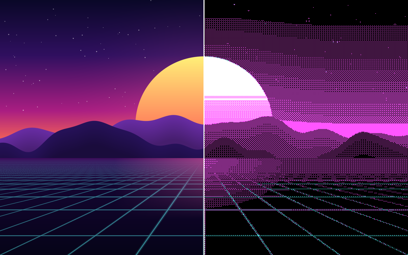


**English** · [Français](README.fr.md)

[Demo page](https://sebjvproj.github.io/retro-filter/en/) · [Download](#download) · [Usage](#usage) · [Palettes](#palettes) · [Build](#build-and-run) · [How it works](#how-it-works)

</div>

## In short

- **Nothing to install in the game.** The filter sits on top of the window. It changes nothing and injects nothing into the program you filter.
- **Play as usual.** The window keeps the keyboard and the mouse, and clicks go straight through the filter.
- **Whole window or one area.** Draw a rectangle with the mouse to filter only the video on a web page.
- **Fast.** The work is done on the graphics card, in 1 to 4 milliseconds per frame at 1920×1080.
- **Private.** No network access, everything stays on your machine.

The project is a working prototype, still in development. The interface is available in English and in French.

## Download

**[Download retro-filter for Windows](https://github.com/sebjvproj/retro-filter/releases/latest/download/retro-filter-windows-x64.zip)** (64-bit, Windows 10 or 11)

1. Unzip the file anywhere.
2. Run **RetroFilter.exe** from the `retro-filter` folder. Nothing else to install.

The app is not signed, so Windows may show "Windows protected your PC" the first time: click **More info**, then **Run anyway**. All versions are on the [releases page](https://github.com/sebjvproj/retro-filter/releases).

## Two modes

| Modern | Period |
|:---:|:---:|
| 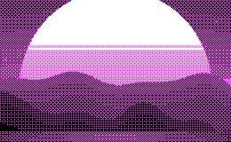 | 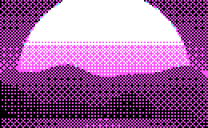 |
| Fine dithering, at screen resolution. The picture stays readable and gradients blend. | 320×200, chunky pixels: what a 1981 PC really displayed. |

## Palettes

The images are actual-size crops of the app's output.

### CGA, 4 colors (1981)

| | | |
|:---:|:---:|:---:|
| 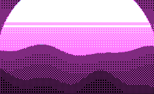 | 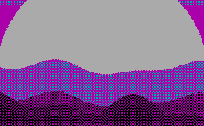 | 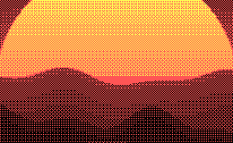 |
| cyan, magenta, white | cyan, magenta, gray (dark) | green, red, yellow |
| 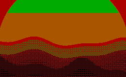 | 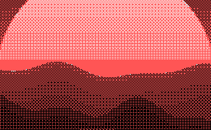 | 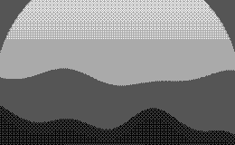 |
| green, red, brown (dark) | cyan, red, white | grayscale |

### EGA, 16 colors (1984)

| | |
|:---:|:---:|
| 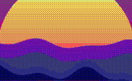 |  |
| 16 colors | grayscale |

## Usage

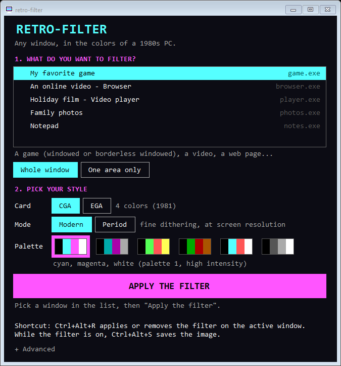

1. Open what you want to filter. For a game, pick **windowed** or **borderless windowed** mode in its display options.
2. In retro-filter, pick the window in the list, then **Whole window** or **One area only**.
3. Pick the style: the **card** (CGA or EGA), the **mode** (Modern or Period) and the **palette**.
4. Click **Apply the filter**. With an area, first draw the rectangle with the mouse.

Closing the window only hides it: the app keeps running in the notification area. Click its icon to reopen it, right-click for the same choices and to quit.

The app starts in French on a French Windows and in English otherwise. You can change the language under **Advanced**.

<br clear="right">

### Shortcuts

| Shortcut | Effect |
|---|---|
| <kbd>Ctrl</kbd>+<kbd>Alt</kbd>+<kbd>R</kbd> | Applies the filter to the active window, or removes it |
| <kbd>Ctrl</kbd>+<kbd>Alt</kbd>+<kbd>S</kbd> | While the filter is on: saves the filtered image and the original as PNG files in `Pictures\retro-filter` |

<kbd>Ctrl</kbd>+<kbd>Alt</kbd>+<kbd>R</kbd> is the only shortcut reserved at all times. More shortcuts (next card, mode and palette, info bar) can be turned on under **Advanced**.

## Build and run

To build the app yourself instead of downloading it, you need:

- Windows 10 version 2004 or later. Windows 11 24H2 is recommended: before that version, Windows limits capture to about 60 frames per second.
- A graphics card that supports Direct3D 11.
- The [.NET 8 SDK](https://dotnet.microsoft.com/download) (`winget install Microsoft.DotNet.SDK.8`).

```
cd src/RetroFilter
dotnet build
bin\Debug\net8.0-windows10.0.26100.0\RetroFilter.exe
```

## Known limits

- **Exclusive fullscreen**: the filter cannot show on top of it. Switch the game to borderless windowed.
- **Protected videos** (most paid streaming services): Windows returns a black image to the capture.
- **Delay**: the filtered image arrives at least one frame after the original.
- **HDR**: capture is 8 bits per color, and an HDR game has not been tested.
- **Area**: it stays fixed relative to the window and is not remembered from one time to the next.

## Privacy and system

- The app makes no network access. Captured images stay on your machine.
- Settings are saved in `%APPDATA%\retro-filter\settings.json`.
- To stay smooth when a game uses the whole graphics card, the app asks Windows for "realtime" GPU priority. No administrator rights are needed.

## How it works

1. **Capture** of the window with Windows Graphics Capture, the same technique OBS uses.
2. **Dithering** in an HLSL shader ([dither.hlsl](src/RetroFilter/Shaders/dither.hlsl)), for each point of the image:
   - average of the area in linear light;
   - search for the pair of palette colors and the mix ratio that best imitate the color (Yliluoma dithering), with the error measured in OKLab, a color space close to human perception;
   - a 4×4 Bayer matrix decides which of the two colors to show.
3. **Display** in a click-through window kept just above the filtered window.

The mixes of every color pair are computed once by the program ([DitherTable.cs](src/RetroFilter/DitherTable.cs)) rather than for every point: that is what makes the 16 EGA colors usable live.

## What is in the repository

Code comments and commit messages are in French.

| Folder | Contents |
|---|---|
| `src/RetroFilter/` | The app (C#, .NET 8, WinForms, Direct3D 11 with [Vortice.Windows](https://github.com/amerkoleci/Vortice.Windows)) |
| `shaders/` | The original shaders in RetroArch `.slang` format, used to develop the algorithm. See [shaders/README.md](shaders/README.md) (in French) |
| `tools/` | `preview.py` applies the algorithm to a screenshot, `compare_gpu.py` compares the app's output with that simulator, `demo_scene.py` draws the demo scene of this page |
| `docs/` | The images of this page, produced by the app from the demo scene |

<details>
<summary><b>Command-line test modes</b></summary>

<br>

`RetroFilter.exe` accepts modes without the interface, useful to check a change. `<title>` is part of the title of the target window.

| Command | Effect |
|---|---|
| `--image <file> <folder> [options]` | Filters an image file, without a window (`palette=N`, pixel size, `0` for period mode) |
| `--snapshot "<title>" <folder>` | Captures a window and saves the original and the filtered image |
| `--verify "<title>"` | Compares the fast shader with the reference shader, for every palette |
| `--bench "<title>"` | Measures the processing time per frame |
| `--fps "<title>" <0\|1\|2>` | Measures the capture rate for a GPU priority level |
| `--overlay "<title>" <folder>` | Checks that the filter stays attached to the window and that clicks go through it |
| `--ui-test <folder> [demo]` | Saves screenshots of the interface |

The images of this page are made like this:

```
python tools/demo_scene.py docs/scene.png 800 500
RetroFilter.exe --image docs/scene.png <folder> palette=0
```

</details>

## License

[MIT](LICENSE).
